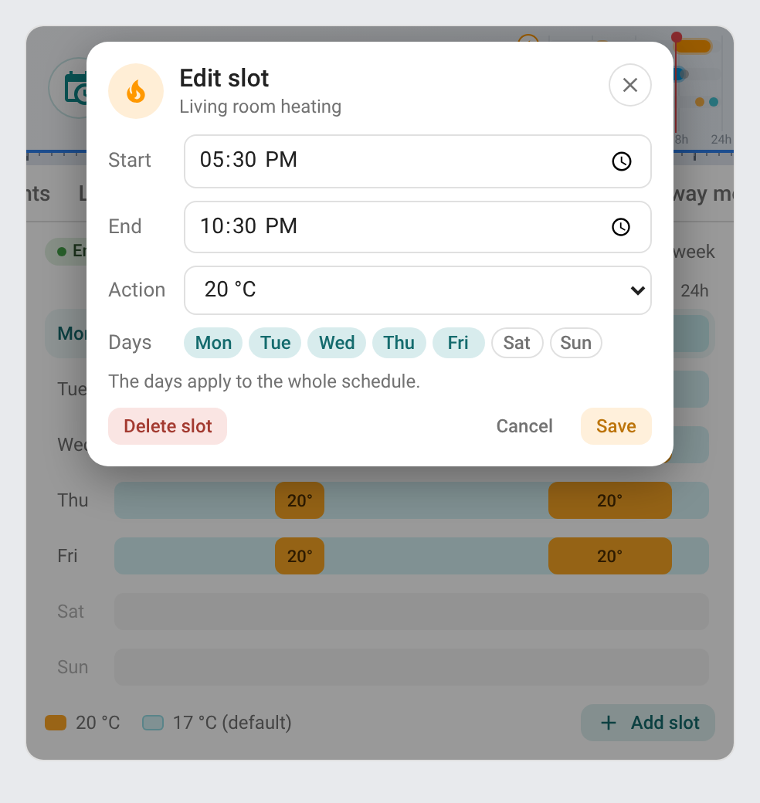
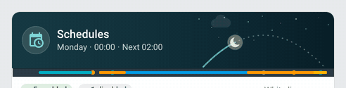
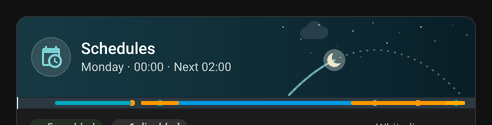
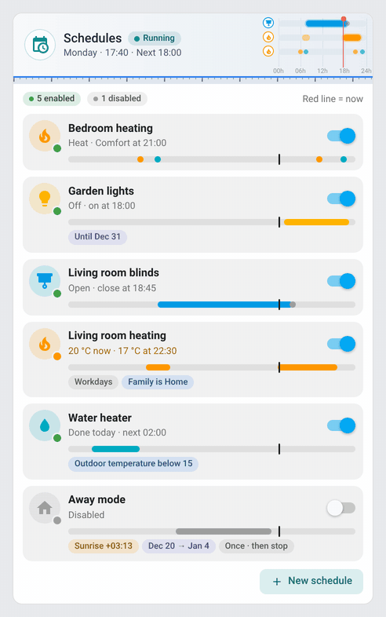
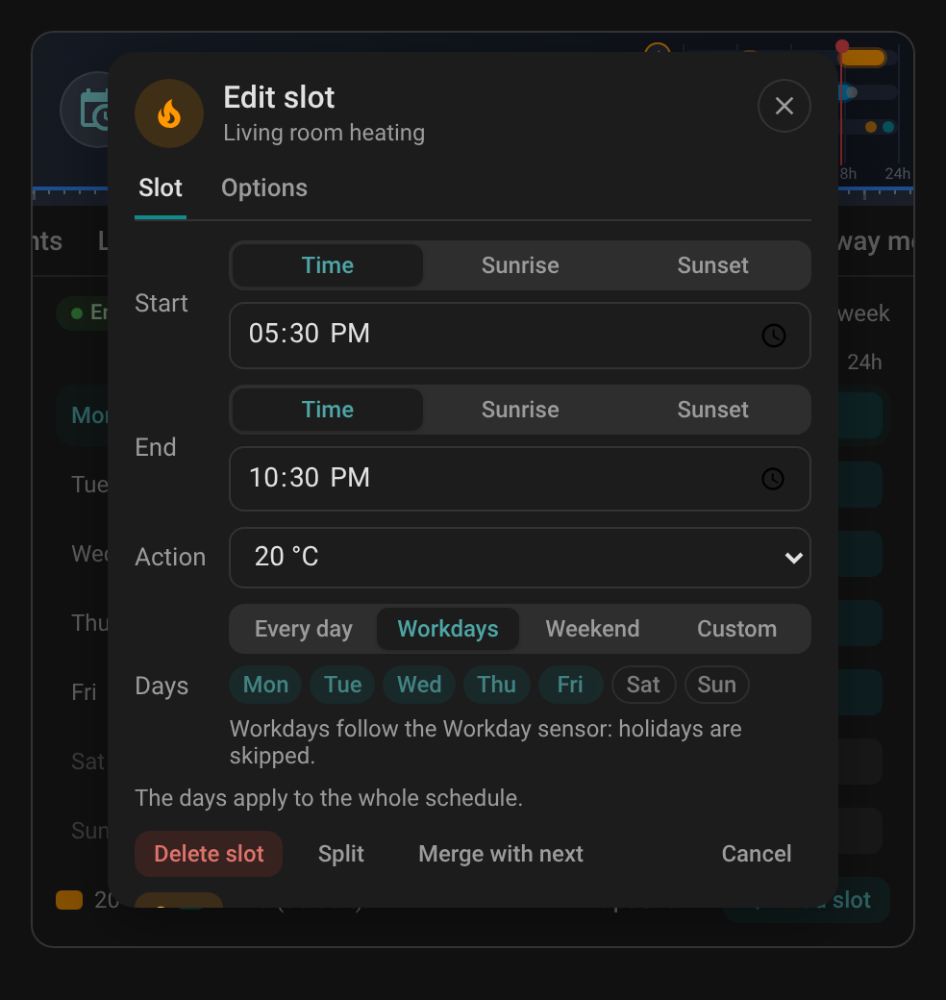
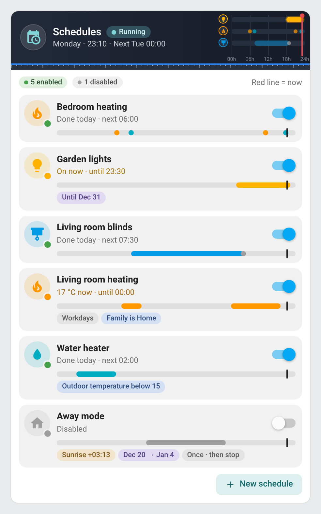
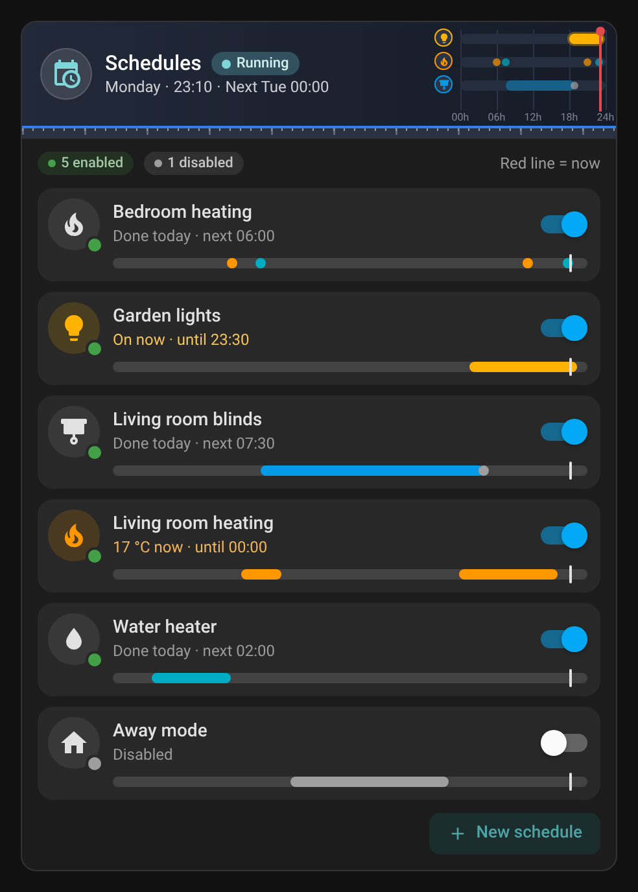
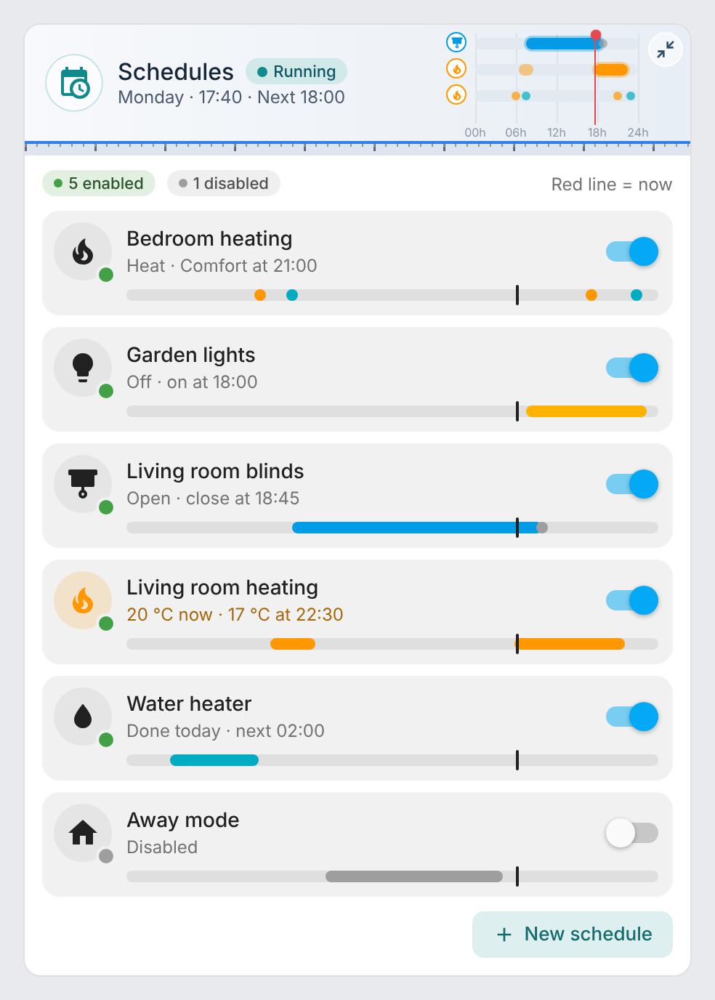
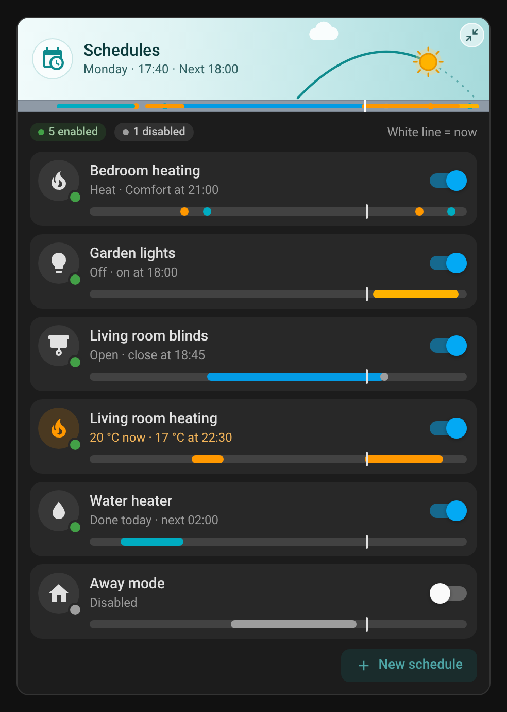

# ha-scheduler-card

[](https://www.home-assistant.io/integrations/marketplace/)
[](https://github.com/juju35/ha-scheduler-card/actions/workflows/hacs.yml)
[](https://github.com/juju35/ha-scheduler-card/actions/workflows/validate.yml)
[](https://github.com/juju35/ha-scheduler-card/actions/workflows/lint.yml)
[](https://github.com/juju35/ha-scheduler-card/releases/latest)
[](https://github.com/juju35/ha-scheduler-card/blob/main/LICENSE)
[](https://buymeacoffee.com/julienstep9)

<p align="center"></p>

**Today's timeline and the weekly grid** of your schedules, for Home Assistant, under an illustrated sky whose sun follows the real time of day: what runs now, what comes next, and every slot of the week at a glance, editable in place.

The cards are built on top of the [Scheduler component](https://github.com/nielsfaber/scheduler-component) by nielsfaber: create your schedules there (or right from the card), add the card, and its `switch.schedule_*` entities are **discovered automatically**.

[](https://my.home-assistant.io/redirect/marketplace_repository/?owner=juju35&repository=ha-scheduler-card&category=plugin)

| Today's timeline | Weekly grid |
|---|---|
| <picture><source media="(prefers-color-scheme: dark)" srcset="https://raw.githubusercontent.com/juju35/ha-scheduler-card/main/screenshots/card-dark.png"></picture> | <picture><source media="(prefers-color-scheme: dark)" srcset="https://raw.githubusercontent.com/juju35/ha-scheduler-card/main/screenshots/card-week-dark.png"></picture> |
| <picture><source media="(prefers-color-scheme: dark)" srcset="https://raw.githubusercontent.com/juju35/ha-scheduler-card/main/screenshots/mini-card-dark.png"></picture> | <picture><source media="(prefers-color-scheme: dark)" srcset="https://raw.githubusercontent.com/juju35/ha-scheduler-card/main/screenshots/card-edit-dark.png"></picture> |

## Features

- Two cards: a full **Scheduler Card** and a compact **Scheduler Mini Card**, of type `custom:scheduler-card` and `custom:scheduler-mini-card`
- The illustration is the header: a teal sky, a drifting cloud, and a **sun that moves along its arc with the real time of day**, from sunrise to sunset (`sun.sun`), its path already travelled drawn behind it; after sunset, the **moon** follows the same arc under a night sky with twinkling stars
- The header's bottom strip shows **today's slots** of every enabled schedule, in their colours, with a white "now" marker
- **Today's timeline**: enabled / disabled chips, then one tile per schedule with
  - the icon of the entity it acts on, coloured only while one of its slots is running, and a green (enabled) or grey (disabled) dot
  - its name and a state line: « 20 °C now · 17 °C at 22:30 », « Off · on at 18:00 », « Open · close at 18:45 », « Done today · next 02:00 », « Disabled »
  - Home Assistant's own **switch** to enable or disable it
  - a **0–24 h bar** of today's slots and a "now" marker
- A tinted **New schedule** button: name, entity, action, times and days, created with `scheduler.add`
- Click a schedule for its **weekly grid**: text tabs to switch schedule, rows Monday to Sunday with the slots as **blocks labelled with their value**, today highlighted with a "now" marker, the value that covers the rest of the day drawn as the background (« 17 °C (default) »), a legend and the **weekly total** (« 20 °C 35 h / week »)
- **Slot editor** in a popup at the top of the card: start, end, action and days, saved with `scheduler.edit`; click an empty spot of the grid (or **Add slot**) to add a slot at that hour; overlapping slots are refused, conditions and dates of the schedule are kept, the last slot's deletion removes the schedule after a confirmation
- Mini card: the next actions of all your schedules (time, coloured icon, name, action), the next one on the right of the title, and a detail button at the top right that unfolds the full card; a click anywhere outside the card folds it back
- Popups close with their button, a click anywhere else, Escape, or when the card leaves the page; the weekly grid folds back to today's timeline the same way
- Filters by `tags` and `entities`, custom `names`, disabled schedules hidden with `show_disabled: false`, read-only cards with `editable: false`
- `illustration: false` for a classic header with a round icon, as on the other cards
- Visual editor for both cards; options left at their default are kept out of the YAML
- Light and dark themes, `prefers-reduced-motion` honoured
- English, French, German, Spanish, Serbian (Cyrillic and Latin), Italian, Dutch, European Portuguese, Polish, Romanian, Danish, Swedish, Bulgarian, Russian, Ukrainian, Hungarian, Slovak, Czech, Slovenian, Latvian and Greek; weekday names from your locale
- Single file, no external dependency: the illustration is drawn in SVG

## Supported integrations

| Integration | What the cards use |
|---|---|
| [Scheduler component](https://github.com/nielsfaber/scheduler-component) by nielsfaber (Marketplace) | The `switch.schedule_*` entities and their attributes (`weekdays`, `timeslots`, `actions`, `entities`, `current_slot`, `tags`); `switch.turn_on` / `switch.turn_off` to enable or disable a schedule; the `scheduler.add`, `scheduler.edit` and `scheduler.remove` services to create, edit and delete; the `scheduler` and `scheduler/item` websocket commands to read a schedule in full before editing it |

The [Workday](https://www.home-assistant.io/integrations/workday/) sensor (`binary_sensor.workday_sensor`) is read for the schedules that run on workdays or at the weekend, as the Scheduler component does.

## Prerequisites

- Home Assistant 2024.8 or later
- The [Scheduler component](https://github.com/nielsfaber/scheduler-component) (3.x)

## Installation

### Via the Marketplace (recommended)

Click the button below to add the repository directly:

[](https://my.home-assistant.io/redirect/marketplace_repository/?owner=juju35&repository=ha-scheduler-card&category=plugin)

Then click **Install**, and reload your browser when the Marketplace asks you to.

Or manually:

1. Open **Settings → Marketplace → Add from link** (top right; this needs a GitHub account connected)
2. Add `https://github.com/juju35/ha-scheduler-card` — Category: **Dashboard** (Lovelace)
3. Open **Scheduler Card** and click **Install**
4. Clear your browser cache and refresh

The Marketplace registers the dashboard resource for you (`/local/community/ha-scheduler-card/scheduler-card.js`); the single file provides both cards.

### Manual

1. Download `scheduler-card.js` and the `scheduler-card.i18n.*.js` translation files from the [latest release](https://github.com/juju35/ha-scheduler-card/releases/latest)
2. Copy them all to `/config/www/` (without the translation files, the cards show in English)
3. Go to **Settings → Dashboards → ⋮ → Resources** → Add resource:
   - URL: `/local/scheduler-card.js`
   - Type: **JavaScript Module**
4. Clear your browser cache and refresh

## Configuration

### Visual editor

Edit a dashboard, click **Add card** and search for **Scheduler Card** or **Scheduler Mini Card**. The schedules are found by themselves; set the title, the illustration theme, the options to show and the language. The preview updates live, and options left at their default are kept out of the generated YAML. The mini card's editor also has the full card's options, used by its unfolded view. The filters (`tags`, `entities`) and `names` are lists or maps: set them in YAML.

### Minimal

```yaml
type: custom:scheduler-card
```

```yaml
type: custom:scheduler-mini-card
```

### Full options

```yaml
type: custom:scheduler-card
title: Heating
tags:
  - heating
entities:
  - climate.living_room
  - switch.schedule_water_heater
names:
  switch.schedule_living_room_heating: Living room
show_disabled: true
editable: true
illustration: true
illustration_theme: auto
language: en
```

```yaml
type: custom:scheduler-mini-card
title: Next actions
next_actions: 5
zoom: true
```

### Options reference

| Option | Card | Default | Description |
|---|---|---|---|
| `title` | both | « Schedules » | Card title (on the weekly grid, the schedule's name is the title) |
| `tags` | both | All | **YAML only.** Only the schedules carrying one of these tags (the Scheduler component's tags); a schedule created from the card gets them |
| `entities` | both | All | **YAML only.** Only these schedules: schedule entities (`switch.schedule_…`) or the entities they act on (`climate.living_room`) |
| `names` | both | Entity name | **YAML only.** A name per schedule entity: `switch.schedule_living_room_heating: Living room` |
| `show_disabled` | both | `true` | Also show the disabled schedules (always last); `false` hides them |
| `editable` | both | `true` | The **New schedule** button, the slot editor and the clickable grid; `false` for a read-only card (the switches still work) |
| `illustration` | both | `true` | The illustrated sky as header; `false` for a classic header with a round icon |
| `illustration_theme` | both | `auto` | `auto` (night when `sun.sun` is below the horizon), `day` or `night` |
| `next_actions` | mini | `3` | Number of upcoming actions listed (1 to 10) |
| `zoom` | mini | `true` | Detail button at the top right: unfolds the full card and back (`false` removes it). The full card's options above apply to the unfolded view and are also set in the mini card's visual editor |
| `language` | both | Auto | Force language: `en`, `fr`, `de`, `es`, `sr`, `sr-Latn`, `it`, `nl`, `pt`, `pl`, `ro`, `da`, `sv`, `bg`, `ru`, `uk`, `hu`, `sk`, `cs`, `sl`, `lv` or `el` (auto-detects from HA settings) |

## Screenshots

### Animations

The sun moves along its arc with the real time of day (here, a whole day in a few seconds): it rises at sunrise, crosses the sky and sets at sunset; then the moon takes its place under the stars, and the white marker of the bottom strip follows the clock. The sun glows, the dashed arc flows and the cloud drifts, in a 12-second loop. With `prefers-reduced-motion`, everything stays still.

Day cycle:

| Light | Dark |
|---|---|
|  |  |

Switching views: a click on a schedule opens its weekly grid, the tabs switch schedule, the arrow goes back to today's timeline; each new view slides in:

| Light | Dark |
|---|---|
|  |  |

### Scheduler Card

Today's timeline:

| Light | Dark |
|---|---|
|  |  |

Weekly grid of a schedule (a workday heating schedule: 20 °C blocks on the 17 °C background):

| Light | Dark |
|---|---|
|  |  |

Slot editor, at the top of the card:

| Light | Dark |
|---|---|
|  |  |

New schedule:

| Light | Dark |
|---|---|
|  |  |

At night (`illustration_theme: night`, or automatic after sunset):

| Light | Dark |
|---|---|
|  |  |

Classic header (`illustration: false`):

| Light | Dark |
|---|---|
|  |  |

### Scheduler Mini Card

| Light | Dark |
|---|---|
|  |  |

Unfolded with its detail button (top right; click it again or anywhere outside the card to go back):

| Light | Dark |
|---|---|
|  |  |

## How it works

### Schedules

The Scheduler component creates one `switch.schedule_…` entity per schedule. The cards find them in the entity registry (platform `scheduler`), and any `switch.schedule_*` entity carrying the component's attributes. Each one is read from its attributes: `weekdays` (`mon` … `sun`, `daily`, `workday`, `weekend`), `timeslots` (« 06:30:00 - 08:30:00 », or a single time for a one-off action; times relative to sunrise or sunset such as `sunset-00:30:00` are placed with `sun.sun`), `actions` (the service and data of each slot), `entities` (what the schedule acts on: its icon and colour), `current_slot` (the slot running now) and `tags`.

The switch of a tile calls `switch.turn_on` / `switch.turn_off` on the schedule entity, like the Scheduler card does. A schedule that has finished its single run (state `completed`) shows as such.

### Today's timeline

A slot with an end is drawn from its start to its end; a one-off action that turns something on (lights on, blinds open) is drawn until the next action that turns it off; other one-off actions are dots. When the slots of a schedule cover the whole day (a thermostat scheme), the value held the longest is its background: only what stands out of it is drawn, on the bars, the header strip and the weekly grid.

The state line tells what runs now and what comes next: the value of the running slot and the next one (« 20 °C now · 17 °C at 22:30 »), or the current state of the entity and the next action (« Off · on at 18:00 »), « Done today · next 02:00 » once today's slots are over, « Disabled ». Temperatures, brightness, positions, presets, options and the usual on/off, open/close, lock, run… are put into words in your language; other services use their name.

### Editing

Before editing, the card reads the full schedule (actions with their entities and data, conditions, dates) with the `scheduler` websocket command (to find it by entity) and `scheduler/item`. Saving sends the whole list of slots back with `scheduler.edit`, sorted by start, with the conditions and the start and end dates of the schedule unchanged; times relative to the sun stay as they are unless you change them. The days apply to the whole schedule, as in the Scheduler component; a workday or weekend schedule keeps that setting while its days are unchanged. A new schedule is created with `scheduler.add` (repeating, with the card's `tags`); deleting a schedule's last slot removes the schedule with `scheduler.remove`.

### Illustration

The banner is drawn in SVG and CSS, with no picture: the sun's place on its arc is the share of the day gone between sunrise and sunset; at night the moon's is the share of the night gone. It follows the clock (checked every 30 seconds). Every animation lasts a divisor of 12 seconds. The scenery is left out on a very narrow card (below about 300 px), where the sky and the strip stay.

### Narrow cards

The full card fits down to 8 columns of a sections view (about 208 px on a phone), the mini card down to 6 columns (about 156 px). State lines wrap, names shorten with an ellipsis, the tab bar scrolls sideways and keeps the shown schedule in sight, and a block too narrow for its value keeps only its colour. In a container sized by its content, the cards take a width of 400 px instead of collapsing.

## Development

```bash
npm install
npm run build        # bundles src/scheduler-card.js into dist/scheduler-card.js and stamps the version of package.json
npm run check        # builds and checks the bundle (run in CI)
npm test             # unit tests, and the browser layout tests (Chromium through Playwright)
npm run screenshots  # renders the cards with mock data (scripts/screenshots/mock.mjs) into screenshots/, and the animation GIFs (needs ffmpeg)
```

`dist/` is not committed: `npm run build` creates it locally, CI builds it on every push, and the release workflow attaches the built file to the release, which is where the Marketplace installs it from. The **Screenshots** workflow renders the captures again on every pull request that changes the sources and commits them to its branch.

### Releasing

1. Bump `version` in `package.json` (and `package-lock.json`)
2. Add a `## <version>` section at the top of [CHANGELOG.md](https://github.com/juju35/ha-scheduler-card/blob/main/CHANGELOG.md)
3. Merge to `main`: the **Release** workflow builds the card, creates the tag and the GitHub release with the changelog section as notes, and attaches `scheduler-card.js` and its translation files

## Translations

The cards auto-detect the language from your Home Assistant settings. Currently supported:

| Language | Code |
|---|---|
| English | `en` |
| Français | `fr` |
| Deutsch | `de` |
| Español | `es` |
| Српски (Serbian, Cyrillic) | `sr` |
| Srpski (Serbian, Latin) | `sr-Latn` |
| Italiano | `it` |
| Nederlands | `nl` |
| Português (Portugal) | `pt` |
| Polski | `pl` |
| Română | `ro` |
| Dansk | `da` |
| Svenska | `sv` |
| Български | `bg` |
| Русский | `ru` |
| Українська | `uk` |
| Magyar | `hu` |
| Slovenčina | `sk` |
| Čeština | `cs` |
| Slovenščina | `sl` |
| Latviešu | `lv` |
| Ελληνικά | `el` |

Contributions for additional languages are welcome!

## Contributing

Issues and pull requests are welcome: bug reports with your card configuration and a browser console extract, ideas, and translation fixes. Before opening a pull request, run `npm test` and `npm run check`; the screenshots are rendered by the CI on the pull request.

## Credits

Schedules by the [Scheduler component](https://github.com/nielsfaber/scheduler-component) by nielsfaber. This project is not affiliated with it. The schedules of the screenshots are fictional.

## License

[MIT](https://github.com/juju35/ha-scheduler-card/blob/main/LICENSE)

## Support

If you find this project useful, you can support its development:

<a href="https://buymeacoffee.com/julienstep9"></a>
