# ha-scheduler-card

[](https://www.home-assistant.io/integrations/marketplace/)
[](https://github.com/juju35/ha-scheduler-card/actions/workflows/hacs.yml)
[](https://github.com/juju35/ha-scheduler-card/actions/workflows/validate.yml)
[](https://github.com/juju35/ha-scheduler-card/actions/workflows/lint.yml)
[](https://github.com/juju35/ha-scheduler-card/releases/latest)
[](https://github.com/juju35/ha-scheduler-card/blob/main/LICENSE)
[](https://buymeacoffee.com/julienstep9)

<p align="center"></p>

**Today's timeline and the weekly grid** of your schedules, for Home Assistant, under an illustrated header that draws today's timeline with a "now" cursor: what runs now, what comes next, and every slot of the week at a glance, editable in place.

The cards are built on top of the [Scheduler component](https://github.com/nielsfaber/scheduler-component) by nielsfaber: create your schedules there (or right from the card), add the card, and its `switch.schedule_*` entities are **discovered automatically**.

[](https://my.home-assistant.io/redirect/marketplace_repository/?owner=juju35&repository=ha-scheduler-card&category=plugin)

| Today's timeline | Weekly grid |
|---|---|
| <picture><source media="(prefers-color-scheme: dark)" srcset="https://raw.githubusercontent.com/juju35/ha-scheduler-card/main/screenshots/card-dark.png">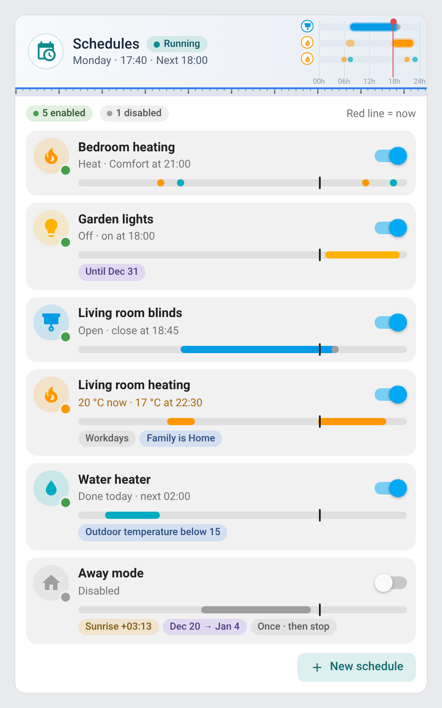</picture> | <picture><source media="(prefers-color-scheme: dark)" srcset="https://raw.githubusercontent.com/juju35/ha-scheduler-card/main/screenshots/card-week-dark.png">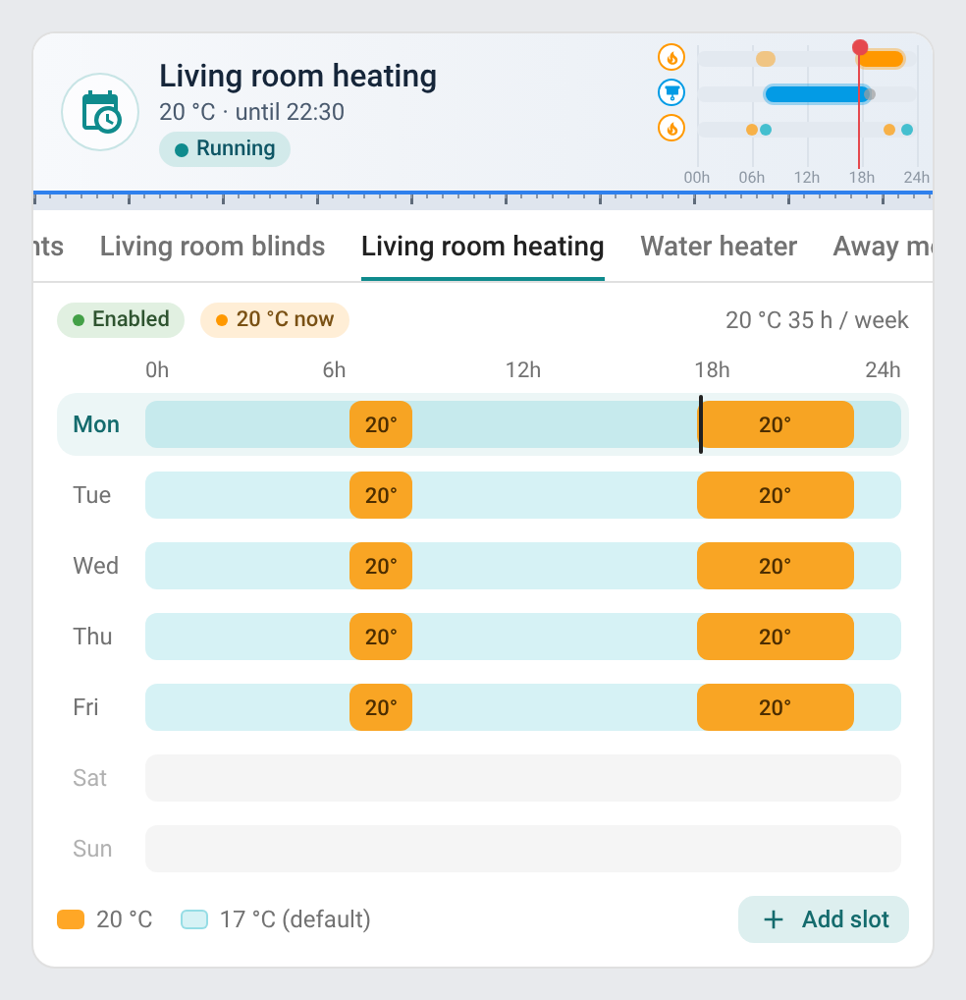</picture> |
| <picture><source media="(prefers-color-scheme: dark)" srcset="https://raw.githubusercontent.com/juju35/ha-scheduler-card/main/screenshots/mini-card-dark.png">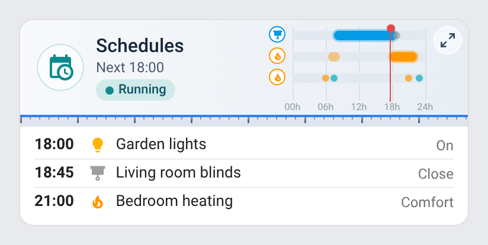</picture> | <picture><source media="(prefers-color-scheme: dark)" srcset="https://raw.githubusercontent.com/juju35/ha-scheduler-card/main/screenshots/card-edit-dark.png"></picture> |

## Features

- Two cards: a full **Scheduler Card** and a compact **Scheduler Mini Card**, of type `custom:scheduler-card` and `custom:scheduler-mini-card`
- The illustration is the header (90 px, on both cards): the title on the sky at the left, and at the right **today's timeline** of up to three schedules (the ones running now first): their icons, their slots as blocks in their colours over 0–24 h, the **slot running now pulsing**, and a red **"now" cursor** that follows the clock; a ruler strip of the day runs along the bottom
- The sky follows the time of day and the theme: **day**, a warmer **evening** in the two hours before sunset (`sun.sun`), and **night** with Home Assistant's dark mode
- The round header icon shows the **status** by its colour: teal while a schedule is running, grey when idle, amber when no schedule matches the card's filters
- **Today's timeline**: enabled / disabled chips, then one tile per schedule with
  - the icon of the entity it acts on in a round tinted badge (grey when disabled), and a status dot: green when enabled, the schedule's colour while a slot runs, grey when disabled
  - its name and a state line: « 20 °C now · 17 °C at 22:30 », « Off · on at 18:00 », « Open · close at 18:45 », « Done today · next 02:00 », « Disabled »
  - Home Assistant's own **switch** to enable or disable it
  - a **0–24 h bar** of today's slots and a "now" marker
  - **badges**: a time relative to the sun (« Sunset −00:30 »), workdays or weekend, its first condition (« Family is Home »), its dates (« Until Dec 31 », « Dec 20 → Jan 4 ») and what happens after its last slot (« Once · then stop »); a schedule starting later reads « Starts Sun, Dec 20 » (`show_badges: false` hides the badges)
- A tinted **New schedule** button: name, **time slots or a single time** (« turn off at 23:00 »), one entity or **several of the same kind**, action, start and end (fixed or **relative to sunrise / sunset**), days, and an **Options** tab; created with `scheduler.add`
- Click a schedule for its **weekly grid**: text tabs to switch schedule, rows Monday to Sunday with the slots as **blocks labelled with their value**, today highlighted with a "now" marker, the value that covers the rest of the day drawn as the background (« 17 °C (default) »), a legend and the **weekly total** (« 20 °C 35 h / week »)
- **Slot editor** in a popup at the top of the card: start and end, each a fixed time or an offset **before / after sunrise or sunset** (with today's time), action, and days as **Every day / Workdays / Weekend** (the Workday sensor's, holidays skipped) or chosen days; saved with `scheduler.edit`; click an empty spot of the grid (or **Add slot**) to add a slot at that hour; **Split** a slot in two or **Merge** it with the next one; overlapping slots are refused, the last slot's deletion removes the schedule after a confirmation
- **Options** of a schedule (a tab of the slot editor, or the **Options** button of the weekly grid): its **name** and **tags**, **conditions** on other entities (is / is not / below / above, all or any of them, optionally re-checked as soon as they change), a **period** between two dates, and **after the last slot**: repeat, stop (disable it) or delete it; and **Duplicate** (`scheduler.copy`)
- **Drag the edges** of a slot on the weekly grid to move its start or end, by the time step (`time_step`, 15 min by default)
- Mini card: the same illustrated header (the next action on its sky), then the next actions of all your schedules (time, coloured icon, name, action), and a detail button at the top right that unfolds the full card; a click anywhere outside the card folds it back
- Popups close with their button, a click anywhere else, Escape, or when the card leaves the page; the weekly grid folds back to today's timeline the same way
- Filters by `tags` (also `none`, `enabled`, `disabled`), `exclude_tags` and `entities`, sorting with `sort_by`, custom `names`, disabled schedules hidden with `show_disabled: false`, read-only cards with `editable: false`
- One switch for all the card's schedules with `show_header_toggle: true`: on while any is enabled, a click from a mixed state disables them all, as Home Assistant's header toggles
- The entities a new schedule can act on narrowed with `include` / `exclude`, and your own actions with `customize`, fixed or with `variables` (a number or a list chosen in the editor, merged into the action's data)
- Conditions guided by their entity: its own entity filters (`condition_include` / `condition_exclude`, with `*` wildcards), a list of the entity's states shown in words (on/off, a select's options, zones, HVAC modes…) while the real state is saved, a number field with the entity's unit and range for numbers and below / above, a free value otherwise or with **Other value…**, and your own states with `condition_states`
- `illustration: false` for a classic header with a round icon, as on the other cards
- Visual editor for both cards; options left at their default are kept out of the YAML
- Light and dark themes, `prefers-reduced-motion` honoured
- English, French, German, Spanish, Serbian (Cyrillic and Latin), Italian, Dutch, European Portuguese, Polish, Romanian, Danish, Swedish, Bulgarian, Russian, Ukrainian, Hungarian, Slovak, Czech, Slovenian, Latvian and Greek; weekday names from your locale
- Single file, no external dependency: the illustration is drawn in HTML and CSS

## Supported integrations

| Integration | What the cards use |
|---|---|
| [Scheduler component](https://github.com/nielsfaber/scheduler-component) by nielsfaber (Marketplace) | The `switch.schedule_*` entities and their attributes (`weekdays`, `timeslots`, `actions`, `entities`, `current_slot`, `tags`); `switch.turn_on` / `switch.turn_off` to enable or disable a schedule; the `scheduler.add`, `scheduler.edit`, `scheduler.copy` and `scheduler.remove` services to create, edit, duplicate and delete; the `scheduler` and `scheduler/item` websocket commands for the full schedules (conditions, dates, repetition), read again on the component's `scheduler_updated` subscription |

The [Workday](https://www.home-assistant.io/integrations/workday/) sensor (`binary_sensor.workday_sensor`) is read for the schedules that run on workdays or at the weekend, as the Scheduler component does.

## Prerequisites

- Home Assistant 2024.8 or later
- The [Scheduler component](https://github.com/nielsfaber/scheduler-component) (3.x)

## Installation

### Via the Marketplace (recommended)

Click the button below to add the repository directly:

[](https://my.home-assistant.io/redirect/marketplace_repository/?owner=juju35&repository=ha-scheduler-card&category=plugin)

Then click **Install**, and reload your browser when the Marketplace asks you to.

Or manually:

1. Open **Settings → Marketplace → Add from link** (top right; this needs a GitHub account connected)
2. Add `https://github.com/juju35/ha-scheduler-card` — Category: **Dashboard** (Lovelace)
3. Open **Scheduler Card** and click **Install**
4. Clear your browser cache and refresh

The Marketplace registers the dashboard resource for you (`/local/community/ha-scheduler-card/scheduler-card.js`); the single file provides both cards.

### Manual

1. Download `scheduler-card.js` and the `scheduler-card.i18n.*.js` translation files from the [latest release](https://github.com/juju35/ha-scheduler-card/releases/latest)
2. Copy them all to `/config/www/` (without the translation files, the cards show in English)
3. Go to **Settings → Dashboards → ⋮ → Resources** → Add resource:
   - URL: `/local/scheduler-card.js`
   - Type: **JavaScript Module**
4. Clear your browser cache and refresh

## Configuration

### Visual editor

Edit a dashboard, click **Add card** and search for **Scheduler Card** or **Scheduler Mini Card**. The schedules are found by themselves; set the title, the illustration theme, the options to show and the language. The preview updates live, and options left at their default are kept out of the generated YAML. The mini card's editor also has the full card's options, used by its unfolded view. The filters `entities`, `tags` and `exclude_tags` are lists picked in the editor (the tags of your schedules are offered, or type a new one); `names` and entities written as objects stay in YAML.

### Minimal

```yaml
type: custom:scheduler-card
```

```yaml
type: custom:scheduler-mini-card
```

### Full options

```yaml
type: custom:scheduler-card
title: Heating
tags:
  - heating
entities:
  - climate.living_room
  - switch.schedule_water_heater
exclude_tags:
  - holidays
names:
  switch.schedule_living_room_heating: Living room
sort_by: next
show_disabled: true
show_badges: true
show_header_toggle: false
editable: true
time_step: 15
include:
  - climate
  - switch.boiler
exclude:
  - climate.guest_room
condition_include:
  - binary_sensor.bedroom_*
  - input_boolean.vacation_mode
  - input_select.energy_tariff
condition_exclude:
  - binary_sensor.bedroom_window
condition_states:
  sensor.heating_mode:
    - value: eco
      name: Economy
    - comfort
  sensor.*_temperature:
    min: -20
    max: 40
    step: 0.5
customize:
  climate.living_room:
    - name: Frost protection
      service: climate.set_temperature
      service_data:
        temperature: 7
    - name: Heat to…
      service: climate.set_temperature
      service_data:
        hvac_mode: heat
      variables:
        temperature:
          name: Temperature
          min: 16
          max: 25
          step: 0.5
          unit: °C
illustration: true
illustration_theme: auto
language: en
```

```yaml
type: custom:scheduler-mini-card
title: Next actions
next_actions: 5
zoom: true
```

### Options reference

| Option | Card | Default | Description |
|---|---|---|---|
| `title` | both | « Schedules » | Card title (on the weekly grid, the schedule's name is the title) |
| `tags` | both | All | Only the schedules carrying one of these tags (the Scheduler component's tags); a schedule created from the card gets them. Special values: `none` (schedules without a tag), `enabled`, `disabled` |
| `exclude_tags` | both | None | Hides the schedules carrying one of these tags (applied after `tags`) |
| `entities` | both | All | Only these schedules: schedule entities (`switch.schedule_…`) or the entities they act on (`climate.living_room`). A list of entity ids in the editor; written as objects (`- entity: …`) it stays YAML-only |
| `names` | both | Entity name | **YAML only.** A name per schedule entity: `switch.schedule_living_room_heating: Living room` |
| `show_disabled` | both | `true` | Also show the disabled schedules (always last); `false` hides them |
| `sort_by` | both | `name` | Order of the schedules: `name`, `next` (soonest next action first) or `state` (running first); disabled ones always last |
| `show_badges` | both | `true` | The badges under each tile (sun, days, condition, dates, after the last slot); `false` hides them |
| `show_header_toggle` | both | `false` | A switch under the header that enables or disables every schedule of the card's `tags`, `exclude_tags` and `entities` (disabled ones included, even hidden by `show_disabled: false`), and nothing else. On while any of them is enabled, as Home Assistant's header toggles: from a mixed state a click disables them all. Only their enabled state changes. On the full card and the mini card's expanded view |
| `editable` | both | `true` | The **New schedule** button, the slot editor, the options and the clickable, draggable grid, and the switches; `false` for a read-only card (the switches are greyed) |
| `time_step` | both | `15` | Minutes: the step of a dragged slot edge, of a split, and of the time fields |
| `include` | both | All | **YAML only.** The entities a new schedule can act on: entity ids, domains or `*` wildcards (`light`, `climate.bedroom`, `switch.*_heater`) |
| `exclude` | both | None | **YAML only.** Entity ids, domains or `*` wildcards left out of the entities a new schedule can act on |
| `condition_include` | both | All | **YAML only.** The entities offered for a condition: entity ids, domains or `*` wildcards (`binary_sensor.bedroom_*`), independently of `include` / `exclude`; conditions already set on other entities stay shown and editable |
| `condition_exclude` | both | None | **YAML only.** Entity ids, domains or `*` wildcards left out of the entities offered for a condition |
| `condition_states` | both | None | **YAML only.** The values offered for a condition on an entity, by entity id, `*` wildcard or domain: a list of states (a state, or `value` and `name`), or a number range (`min`, `max`, `step`, `unit`) |
| `customize` | both | None | **YAML only.** Your own actions, by entity id or domain: a list of `name`, `service`, `service_data` and `variables`, offered first in the editors (see [Custom actions with variables](#custom-actions-with-variables)) |
| `illustration` | both | `true` | The illustrated header with today's timeline; `false` for a classic header with a round icon |
| `illustration_theme` | both | `auto` | `auto` (follows the Home Assistant theme: night with a dark theme, day with a light theme, evening in the two hours before sunset with a light theme), `day` or `night` |
| `next_actions` | mini | `3` | Number of upcoming actions listed (1 to 10) |
| `zoom` | mini | `true` | Detail button at the top right: unfolds the full card and back (`false` removes it). The full card's options above apply to the unfolded view and are also set in the mini card's visual editor |
| `language` | both | Auto | Force language: `en`, `fr`, `de`, `es`, `sr`, `sr-Latn`, `it`, `nl`, `pt`, `pl`, `ro`, `da`, `sv`, `bg`, `ru`, `uk`, `hu`, `sk`, `cs`, `sl`, `lv` or `el` (auto-detects from HA settings) |


### Custom actions with variables

A custom action of `customize` can leave some of its data to be chosen in the editor: each entry of `variables`, keyed by the `service_data` field it sets, adds a field under the action. The chosen values are merged into the fixed `service_data` and stored as ordinary action data. Several variables can go on the same action.

```yaml
customize:
  climate.bedroom:
    - name: Heat to…
      service: climate.set_temperature
      service_data:
        hvac_mode: heat
      variables:
        temperature:
          name: Temperature
          min: 16
          max: 25
          step: 0.5
          unit: °C
  script:
    - name: Comfort
      service: script.comfort
      variables:
        temperature:
          min: 16
          max: 25
          step: 0.5
        fan_mode:
          name: Fan
          options:
            - value: low
              name: Low
              icon: mdi:fan-speed-1
            - value: high
              name: High
            - auto
        brightness:
          name: Brightness
          min: 0
          max: 100
          unit: "%"
          scale_factor: 2.55
          optional: true
```

| Key | Applies to | Description |
|---|---|---|
| `name` | number, list | Label of the field (by default the field's name) |
| `optional` | number, list | `true`: the field can be left empty, and is then left out of the action's data |
| `min`, `max`, `step`, `unit` | number | Range, step and unit of the number field; a value out of range is refused |
| `scale_factor` | number | The value is multiplied by it when stored and divided by it when shown: `2.55` shows a brightness (0–255) as a percentage |
| `options` | list | The choices: plain values, or `value` (stored), `name` (shown) and `icon` (shown beside the list) |

Editing a slot whose stored action matches a custom action with variables (same service, same fixed data, a value for every required variable) selects it with its stored values; data the action does not set is kept as is.

## Screenshots

### Animations

The "now" cursor crosses today's timeline with the real time of day (here, a whole day in a few seconds), under the day and evening skies (night with the dark theme); the slot running now pulses, in a 12-second loop. With `prefers-reduced-motion`, everything stays still.

Day cycle:

| Light | Dark |
|---|---|
| 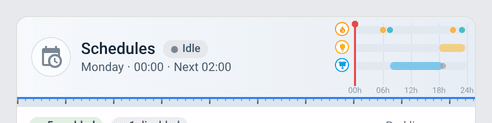 | 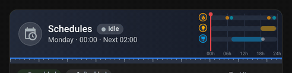 |

Switching views: a click on a schedule opens its weekly grid, the tabs switch schedule, the arrow goes back to today's timeline; each new view slides in:

| Light | Dark |
|---|---|
|  | 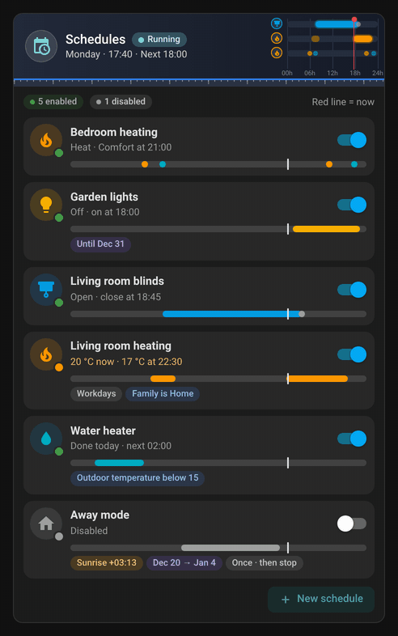 |

### Scheduler Card

Today's timeline:

| Light | Dark |
|---|---|
|  | 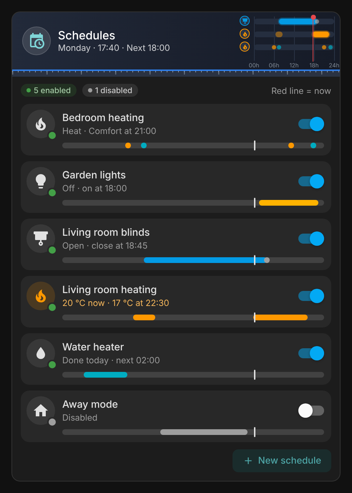 |

Weekly grid of a schedule (a workday heating schedule: 20 °C blocks on the 17 °C background):

| Light | Dark |
|---|---|
|  | 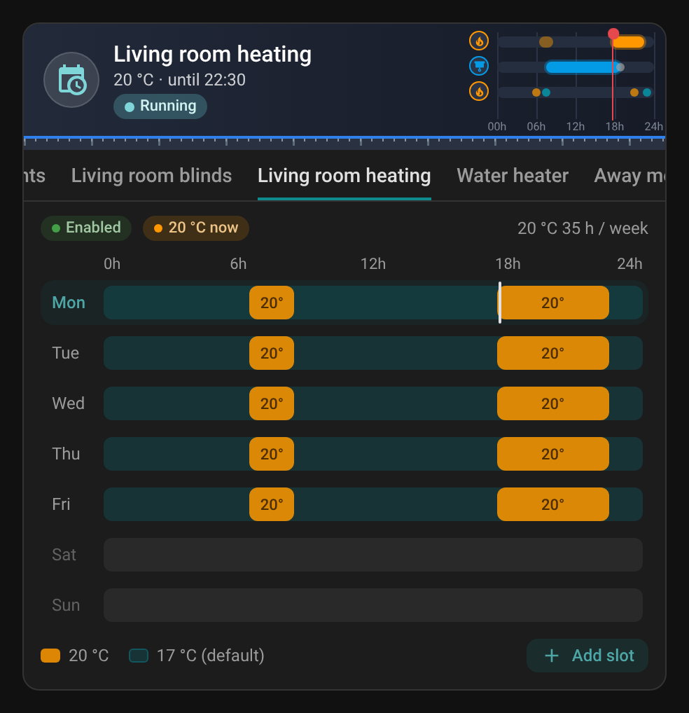 |

Slot editor, at the top of the card:

| Light | Dark |
|---|---|
|  |  |

A slot starting after sunrise, with today's time, and the day presets:

| Light | Dark |
|---|---|
| 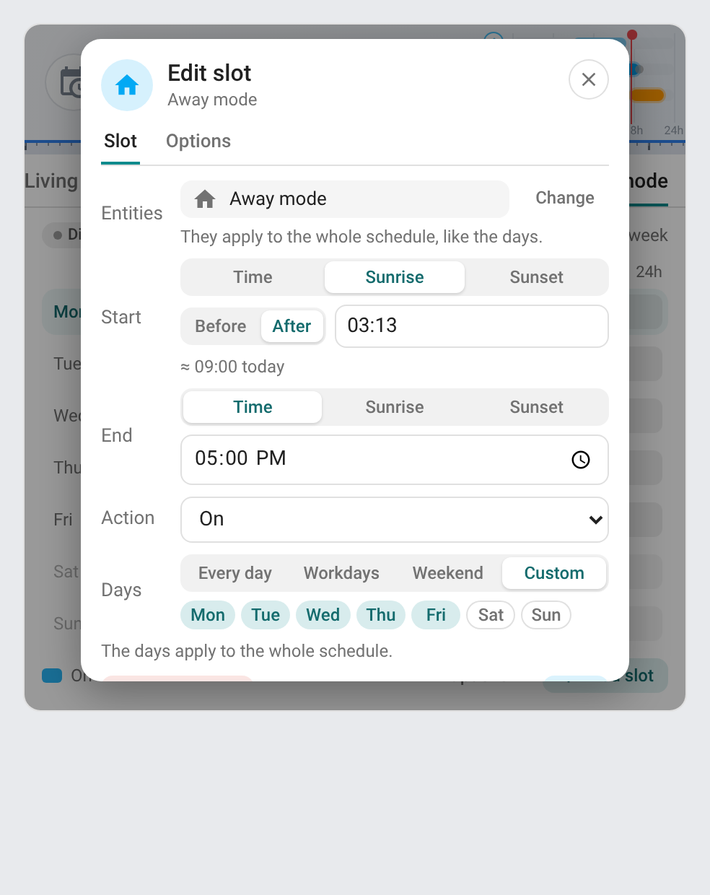 | 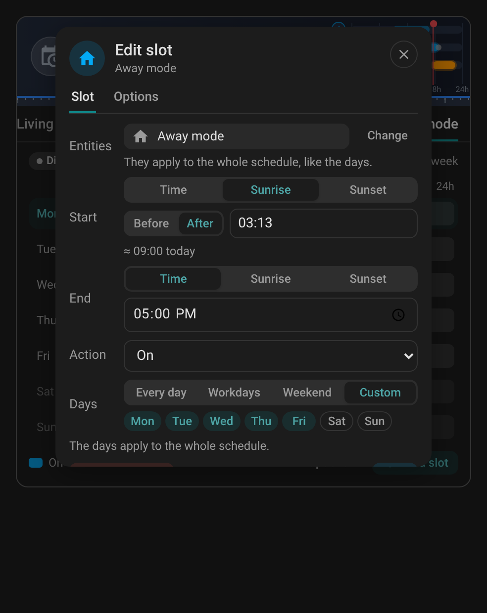 |

Options of a schedule: name, tags, conditions, period, after the last slot:

| Light | Dark |
|---|---|
| 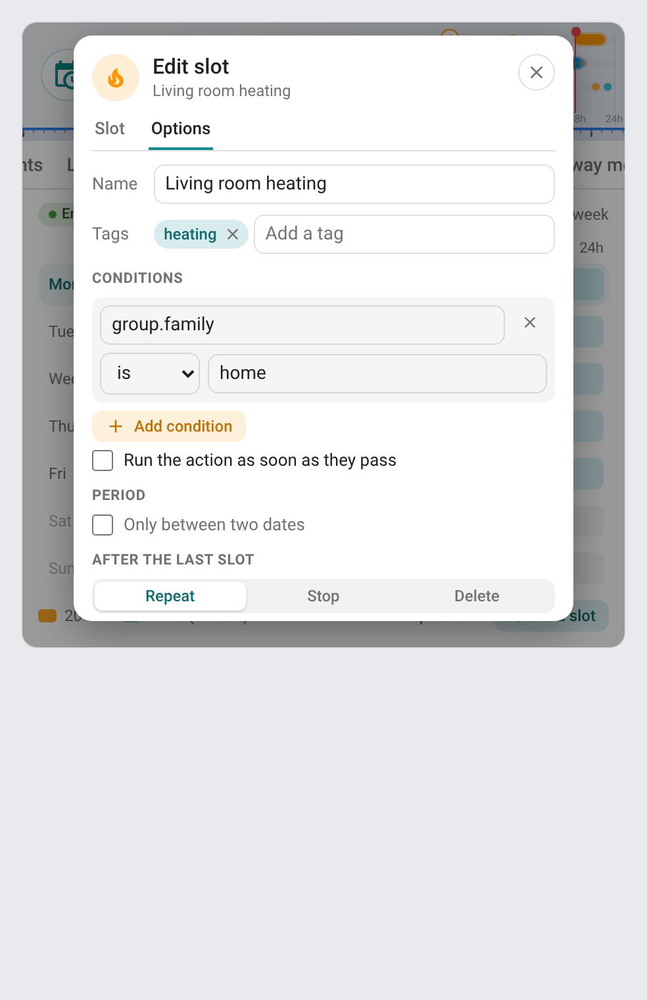 | 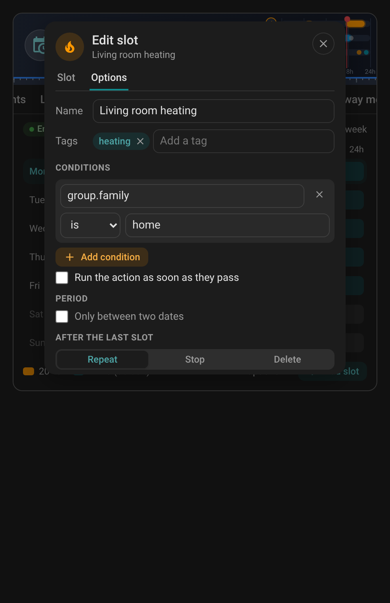 |

New schedule:

| Light | Dark |
|---|---|
| 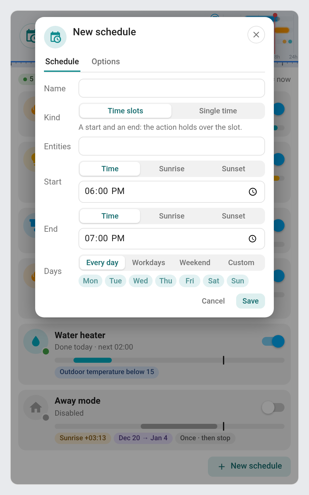 | 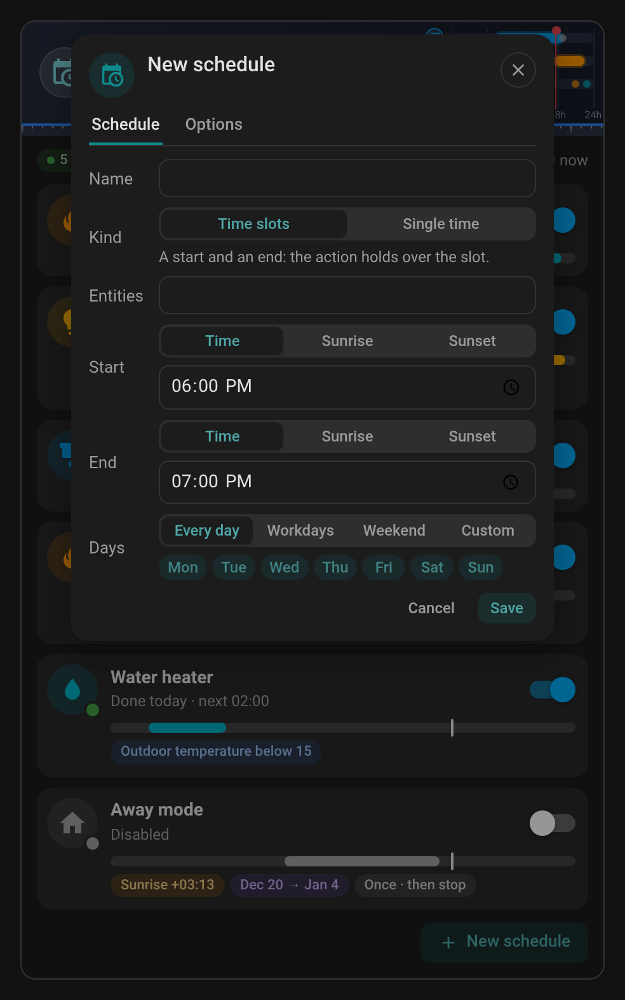 |

At night (`illustration_theme: night`, or automatic with a dark theme):

| Light | Dark |
|---|---|
|  |  |

Classic header (`illustration: false`):

| Light | Dark |
|---|---|
| 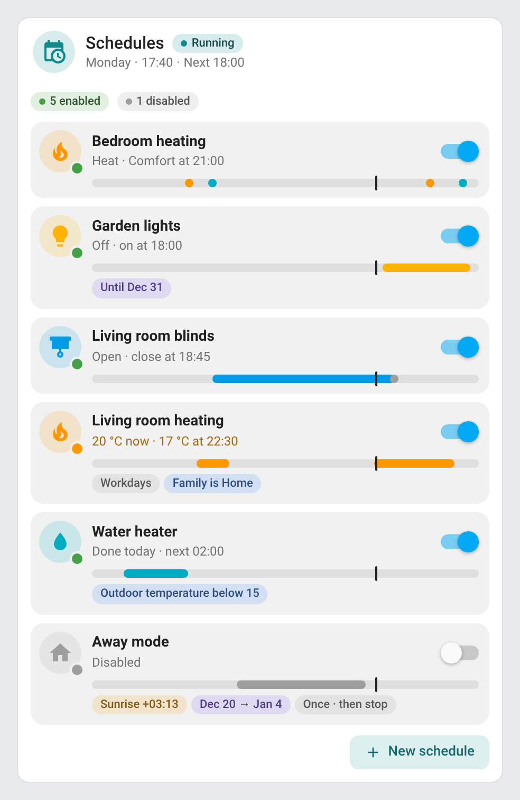 | 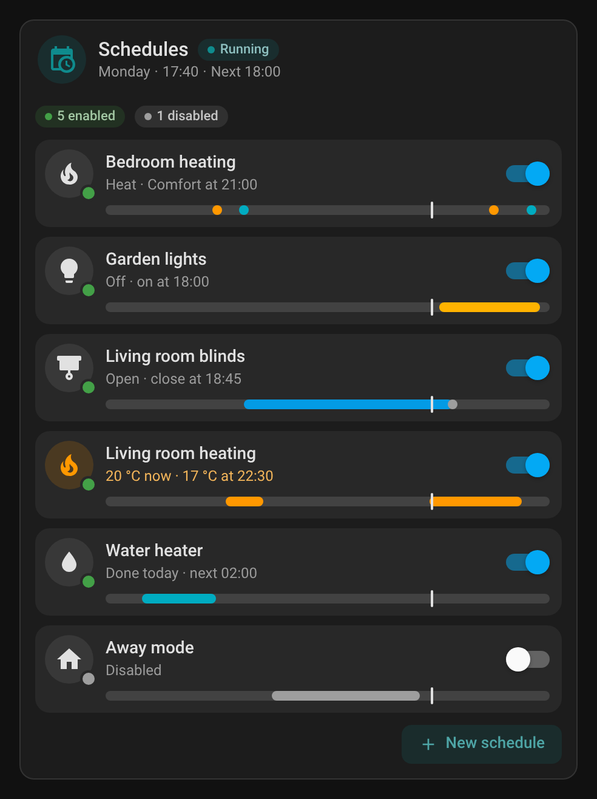 |

### Scheduler Mini Card

| Light | Dark |
|---|---|
|  | 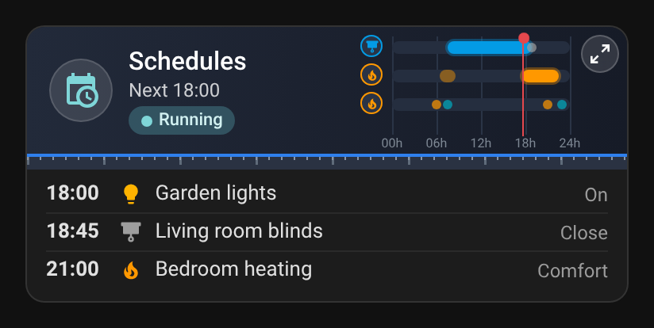 |

Unfolded with its detail button (top right; click it again or anywhere outside the card to go back):

| Light | Dark |
|---|---|
|  |  |

## How it works

### Schedules

The Scheduler component creates one `switch.schedule_…` entity per schedule. The cards find them in the entity registry (platform `scheduler`), and any `switch.schedule_*` entity carrying the component's attributes. Each one is read from its attributes: `weekdays` (`mon` … `sun`, `daily`, `workday`, `weekend`), `timeslots` (« 06:30:00 - 08:30:00 », or a single time for a one-off action; times relative to sunrise or sunset such as `sunset-00:30:00` are placed with `sun.sun`), `actions` (the service and data of each slot), `entities` (what the schedule acts on: its icon and colour), `current_slot` (the slot running now) and `tags`.

The switch of a tile calls `switch.turn_on` / `switch.turn_off` on the schedule entity, like the Scheduler card does. A schedule that has finished its single run (state `completed`) shows as such.

### Today's timeline

A slot with an end is drawn from its start to its end; a one-off action that turns something on (lights on, blinds open) is drawn until the next action that turns it off; other one-off actions are dots. When the slots of a schedule cover the whole day (a thermostat scheme), the value held the longest is its background: only what stands out of it is drawn, on the bars, the header strip and the weekly grid.

The state line tells what runs now and what comes next: the value of the running slot and the next one (« 20 °C now · 17 °C at 22:30 »), or the current state of the entity and the next action (« Off · on at 18:00 »), « Done today · next 02:00 » once today's slots are over, « Disabled ». Temperatures, brightness, positions, presets, options and the usual on/off, open/close, lock, run… are put into words in your language; other services use their name.

### Editing

Before editing, the card reads the full schedule (actions with their entities and data, conditions, dates) with the `scheduler` websocket command (to find it by entity) and `scheduler/item`. Saving sends the whole list of slots back with `scheduler.edit`, sorted by start, with the conditions and the start and end dates of the schedule unchanged; times relative to the sun stay as they are unless you change them. The days apply to the whole schedule, as in the Scheduler component; a workday or weekend schedule keeps that setting while its days are unchanged. A new schedule is created with `scheduler.add` (repeating, with the card's `tags`); deleting a schedule's last slot removes the schedule with `scheduler.remove`.

### Illustration

The banner is drawn in HTML and CSS, with no picture: each schedule's row shows today's slots on a 0–24 h track (the background value of a schedule covering the whole day left out), a red cursor marks the current minute, and the slot it falls in pulses. It follows the clock (checked every 30 seconds). Every animation lasts a divisor of 12 seconds. The timeline is left out on a very narrow card (below about 300 px), where the sky and the strip stay.

### Narrow cards

The full card fits down to 8 columns of a sections view (about 208 px on a phone), the mini card down to 6 columns (about 156 px). State lines wrap, names shorten with an ellipsis, the tab bar scrolls sideways and keeps the shown schedule in sight, and a block too narrow for its value keeps only its colour. In a container sized by its content, the cards take a width of 400 px instead of collapsing.

## Development

```bash
npm install
npm run build        # bundles src/scheduler-card.js into dist/scheduler-card.js and stamps the version of package.json
npm run check        # builds and checks the bundle (run in CI)
npm test             # unit tests, and the browser layout tests (Chromium through Playwright)
npm run screenshots  # renders the cards with mock data (scripts/screenshots/mock.mjs) into screenshots/, and the animation GIFs (needs ffmpeg)
```

`dist/` is not committed: `npm run build` creates it locally, CI builds it on every push, and the release workflow attaches the built file to the release, which is where the Marketplace installs it from. The **Screenshots** workflow renders the captures again on every pull request that changes the sources and commits them to its branch.

### Releasing

1. Bump `version` in `package.json` (and `package-lock.json`)
2. Add a `## <version>` section at the top of [CHANGELOG.md](https://github.com/juju35/ha-scheduler-card/blob/main/CHANGELOG.md)
3. Merge to `main`: the **Release** workflow builds the card, creates the tag and the GitHub release with the changelog section as notes, and attaches `scheduler-card.js` and its translation files

## Translations

The cards auto-detect the language from your Home Assistant settings. Currently supported:

| Language | Code |
|---|---|
| English | `en` |
| Français | `fr` |
| Deutsch | `de` |
| Español | `es` |
| Српски (Serbian, Cyrillic) | `sr` |
| Srpski (Serbian, Latin) | `sr-Latn` |
| Italiano | `it` |
| Nederlands | `nl` |
| Português (Portugal) | `pt` |
| Polski | `pl` |
| Română | `ro` |
| Dansk | `da` |
| Svenska | `sv` |
| Български | `bg` |
| Русский | `ru` |
| Українська | `uk` |
| Magyar | `hu` |
| Slovenčina | `sk` |
| Čeština | `cs` |
| Slovenščina | `sl` |
| Latviešu | `lv` |
| Ελληνικά | `el` |

Contributions for additional languages are welcome!

## Contributing

Issues and pull requests are welcome: bug reports with your card configuration and a browser console extract, ideas, and translation fixes. Before opening a pull request, run `npm test` and `npm run check`; the screenshots are rendered by the CI on the pull request.

## Credits

Schedules by the [Scheduler component](https://github.com/nielsfaber/scheduler-component) by nielsfaber. This project is not affiliated with it. The schedules of the screenshots are fictional.

## License

[MIT](https://github.com/juju35/ha-scheduler-card/blob/main/LICENSE)

## Support

If you find this project useful, you can support its development:

<a href="https://buymeacoffee.com/julienstep9"></a>
